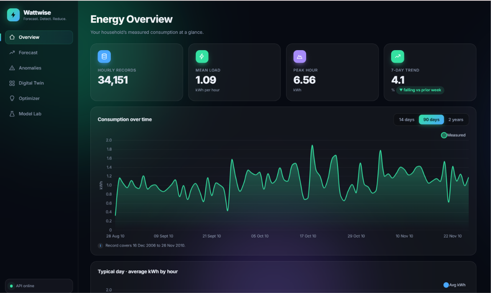
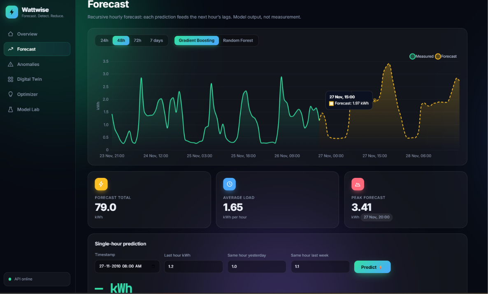
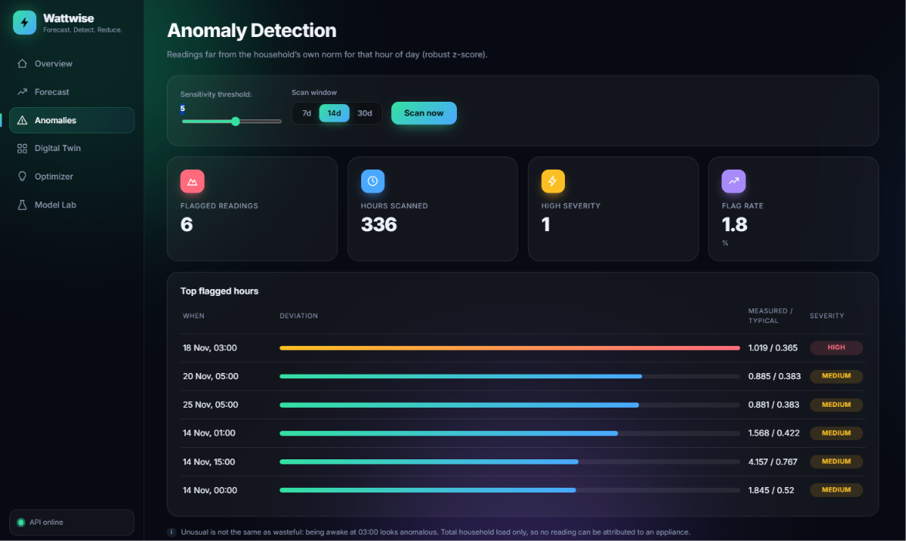
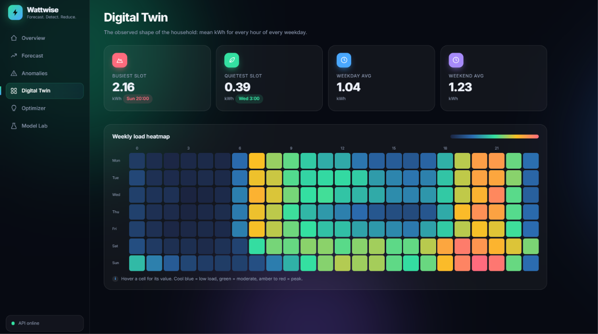
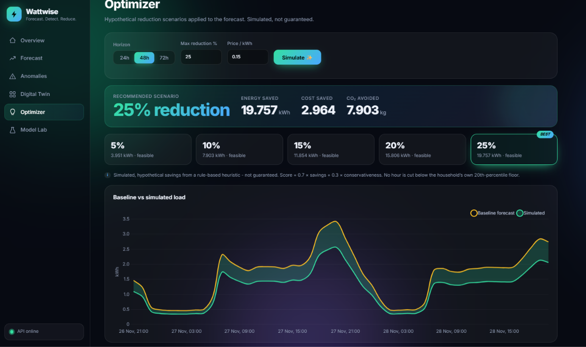
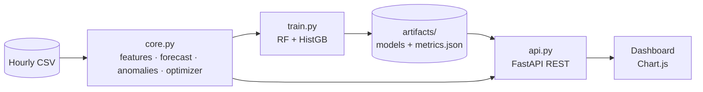

<div align="center">

# ⚡ Wattwise
### Forecast. Detect. Reduce.

**An energy "digital twin" that forecasts household electricity use, flags unusual consumption, and simulates how much you could save.**


[**🚀 Live Demo**](https://wattwise-6m9o.onrender.com/) · [API Docs](https://wattwise-6m9o.onrender.com/docs)



</div>

---

## 🎯 The Problem
Households get a monthly bill but no insight into *when* energy is used, *what* is unusual, or *how much* could realistically be saved. Wattwise turns raw hourly smart-meter data into forecasts, alerts and savings scenarios.

## 📸 Screenshots

| Forecast | Anomalies |
|---|---|
|  |  |
| **Digital Twin** | **Optimizer** |
|  |  |

## ✨ What It Does

| Module | What you get |
|---|---|
| 📈 **Forecasting** | Predicts the next 24 h to 7 days of consumption with Random Forest or Gradient Boosting |
| 🚨 **Anomaly Detection** | Flags hours that are abnormal *for that hour of day* using a robust z-score (median / MAD) |
| 🏠 **Digital Twin** | Weekly heatmap showing the household's load pattern for every hour of every weekday |
| 💡 **Optimizer** | Simulates 5–25 % reduction scenarios and reports kWh, cost and CO₂ saved |
| 🧪 **Model Lab** | Transparent model comparison and feature importance |

## 📊 Results

Evaluated on a **chronological 80/20 hold-out** (6,675 unseen hours, Jan to Nov 2010). No random shuffling, so there is no future-data leakage.

| Model | MAE (kWh) | RMSE (kWh) | MAE improvement vs baseline |
|---|---|---|---|
| Previous-hour baseline | 0.3989 | 0.6058 | – |
| Random Forest | 0.3399 | 0.4920 | **14.8 %** |
| **Gradient Boosting** | **0.3354** | **0.4822** | **15.9 %** |

- Gradient Boosting reduces RMSE by about **20 %** against a naive "same as last hour" baseline.
- `lag_1` (previous hour) is the strongest feature at about 81 % importance, followed by `hour` of day at about 14 %.

## 🏗️ Architecture



**Feature engineering:** hour, day of week, month, and lag features at 1 h, 24 h and 168 h (same hour yesterday and last week).
**Forecasting method:** recursive multi-step prediction. Each predicted hour feeds the next hour's lags.

## 🔌 API Endpoints

| Method | Endpoint | Purpose |
|---|---|---|
| GET | `/api/health` | Service status |
| GET | `/api/overview` | Dataset KPIs and weekly trend |
| GET | `/api/history` | Aggregated history (hour / day / week) |
| GET | `/api/profile` | Weekday × hour load profile |
| GET | `/api/anomalies` | Detected anomalies with severity |
| POST | `/api/forecast` | Multi-hour recursive forecast |
| POST | `/api/predict` | Single-hour prediction |
| POST | `/api/optimize` | Reduction scenarios and recommendation |
| GET | `/api/models` | Metrics and feature importance |

Interactive docs are available at `/docs` (Swagger UI).

## 🚀 Run Locally

```bash
git clone https://github.com/Swati Priya/wattwise.git
cd wattwise
python -m venv .venv
.venv\Scripts\activate            # macOS/Linux: source .venv/bin/activate
pip install -r requirements.txt
python train.py                   # optional: trained models are already included
uvicorn api:app --reload --port 8000
```
Open **http://127.0.0.1:8000**

## 📁 Project Structure

```
wattwise/
├── core.py            # data loading, features, forecast, anomalies, optimizer
├── train.py           # training + evaluation, writes artifacts/
├── api.py             # FastAPI app (9 endpoints)
├── static/index.html  # dashboard UI
├── data/              # hourly_energy.csv
├── artifacts/         # trained models + metrics.json
└── requirements.txt
```

## 🧠 Design Decisions and Honest Limitations

- **Time-aware validation:** the split is chronological, because random splits leak the future in time-series.
- **Gaps are not invented:** missing hours stay missing, and forecasts fall back to the hour-of-day median when a lag is absent.
- **Anomalies are not "waste":** they mean unusual for that hour. Being awake at 3 AM looks anomalous but is not wasteful.
- **Optimizer is a transparent heuristic, not a learned policy:** score = 0.7 × savings + 0.3 × conservativeness, and no hour is cut below the household's own 20th-percentile floor. Savings are simulated, not guaranteed.
- **Total load only:** there is no per-appliance attribution in the dataset.

## 🔭 Future Work
- Prediction intervals (quantile regression) for forecast uncertainty
- Weather and holiday features
- LSTM / Prophet comparison against tree models
- Docker image and CI pipeline

## 🛠️ Tech Stack
Python · pandas · NumPy · scikit-learn (RandomForest, HistGradientBoosting) · joblib · FastAPI · Uvicorn · Chart.js

---
<div align="center">Built by <b>YOUR NAME</b> · <a href="https://www.linkedin.com/in/YOUR-LINKEDIN">LinkedIn</a> · <a href="https://github.com/swati61priya-star">GitHub</a></div>
